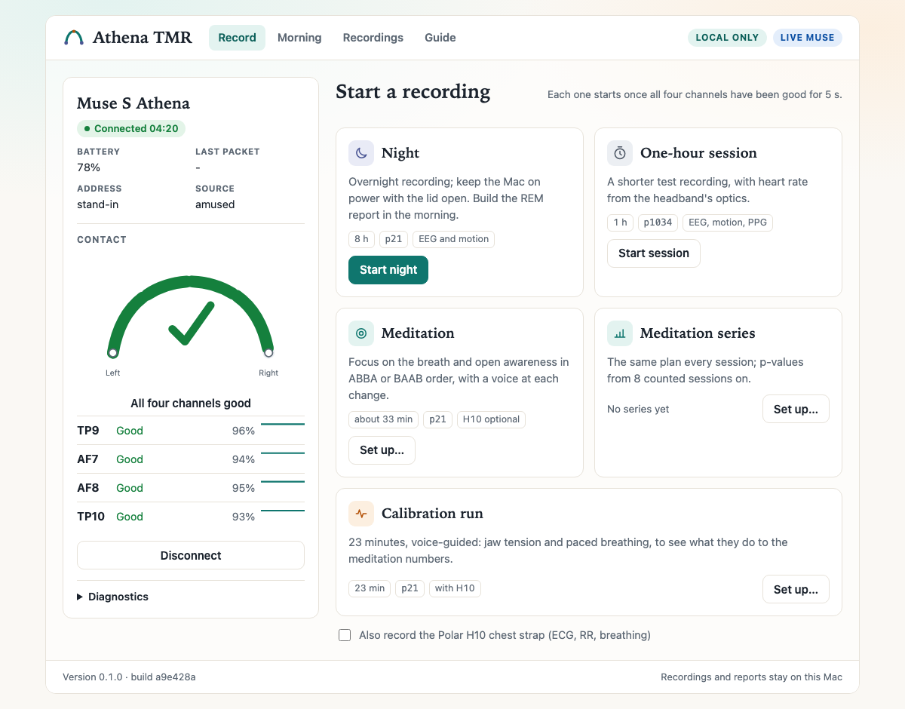
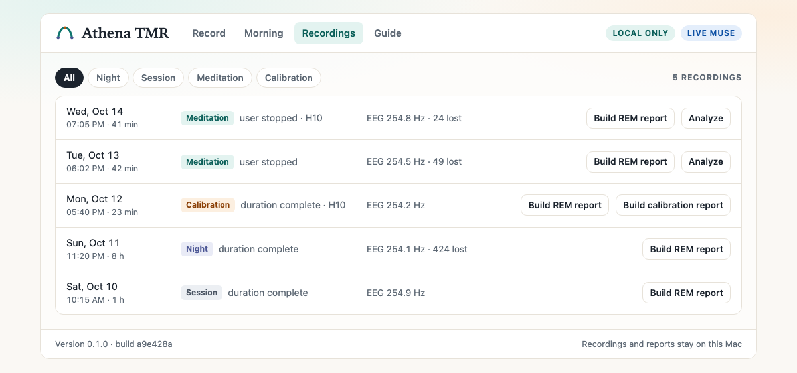
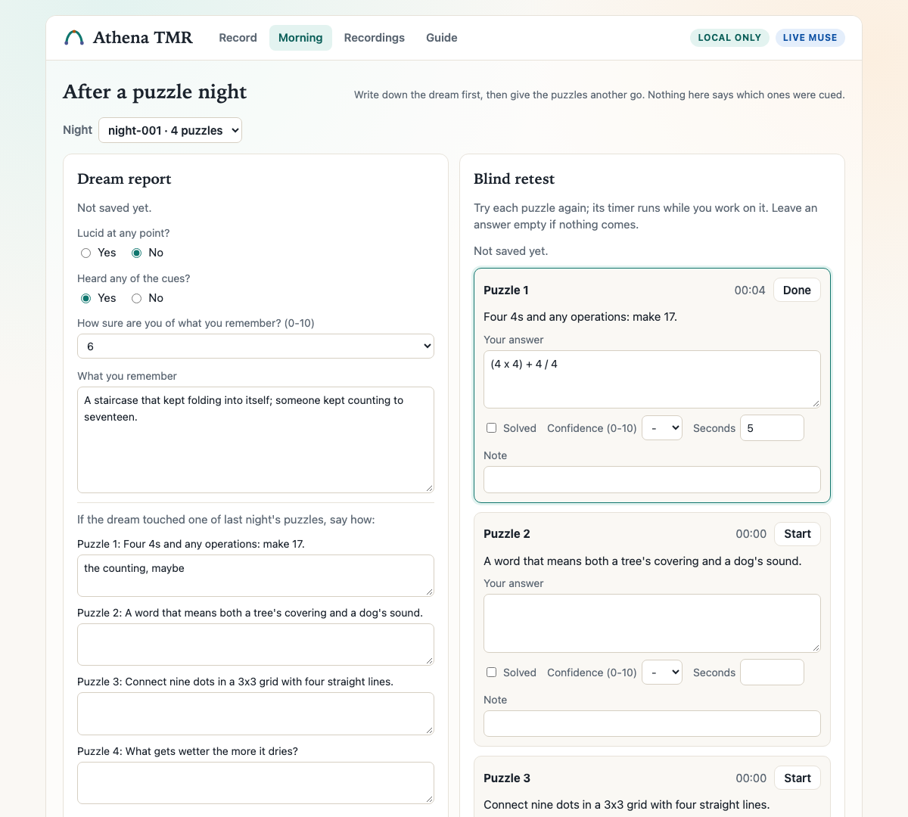

# REMind

**REM-gated Targeted Memory Reactivation engine for the Muse S Athena EEG headset — overnight recording, real-time REM detection, and safety-gated audio cueing for a one-way, REM-timed cue protocol: a cue paired with a puzzle or lucidity intention before sleep, replayed when the stable REM gate opens; no eye-signal verification. Python.**

Repository `remind-eeg`, Python package `muse_tmr`, command `muse-tmr`. The pip distribution in `pyproject.toml` is still `athena-tmr-lucid`; it will be renamed `remind-eeg`.

[](https://www.python.org/downloads/)
[](LICENSE)
[](https://github.com/yuriy-mikityuk/remind-eeg/actions)

The system records sleep biosignals all night (EEG, IMU, PPG), detects REM in real time, and plays quiet audio cues only when a stack of safety gates agrees it is safe to do so. Around that core it implements a full single-subject experimental protocol: pre-sleep puzzle sessions with seeded cued/uncued randomization, TLR cue familiarization, REM-gated cueing at night, and morning dream reports with blind retests and cued-vs-uncued analysis.

## Project status (2026-10-23)

Not a medical device. This is n = 1 research software for self-experimentation, with no clinical, diagnostic, therapeutic or lucid-dreaming claims. The engineering targets are protocol fidelity, safety guardrails, structured logging and measurable validation. Where the evidence stands:

- Every accuracy figure comes from one EEG-only night, `overnight_20260707` (`p21`, 8 h, no audio), scored against GSSC, an automated stager used as a proxy, not PSG ([#112](https://github.com/yuriy-mikityuk/remind-eeg/issues/112), [PR #115](https://github.com/yuriy-mikityuk/remind-eeg/pull/115)).
- The `p21` gate thresholds 0.90/0.85 were tuned in-sample on that night and reported on the same night, so they are not a held-out result ([PR #115](https://github.com/yuriy-mikityuk/remind-eeg/pull/115), [`docs/numbers.md`](docs/numbers.md)).
- No night with sleep-time audio has been run yet; Pilots 4 and 5 exist as tooling only ([EPIC #1](https://github.com/yuriy-mikityuk/remind-eeg/issues/1)).
- The heuristic detector is effectively one feature: against GSSC only `low_delta_power` separates REM, and the eye-movement proxy is saturated, so its weight is now 0; the `p21` thresholds were tuned before that and wait for a re-grid ([#116](https://github.com/yuriy-mikityuk/remind-eeg/issues/116), [#225](https://github.com/yuriy-mikityuk/remind-eeg/issues/225)). Its replacement, a count of eye-movement deflections on band-passed AF7 − AF8, is computed and exported at weight 0 and has only been checked on synthetic input; fitting it needs REM-bearing nights.
- With 30 s epochs and a 60 s stable window, the first cue comes at least 60 to 90 s after REM onset ([#167](https://github.com/yuriy-mikityuk/remind-eeg/issues/167)).
- The pip distribution is still `athena-tmr-lucid`. It will be renamed `remind-eeg`, keeping the `muse-tmr` command and the `muse_tmr` import; the rename itself is [Initiative 8, #232](https://github.com/yuriy-mikityuk/remind-eeg/issues/232).

How REMind relates to the other open projects: [`docs/compare.md`](docs/compare.md). Answers to what comes up in the issues: [`docs/faq.md`](docs/faq.md). The papers: [`docs/references.md`](docs/references.md).



| Recordings | Morning |
| --- | --- |
|  |  |

The pictures show the app on example data.

## Highlights

- **Real-time pipeline:** BLE frames → 30-second epochs → multi-modal features → REM detection → stable gate → arousal guard → cue scheduler → volume-capped audio
- **Multi-modal feature extraction:** EEG band powers (delta–gamma), relative powers, theta–alpha and slow–fast ratios, frontal/posterior asymmetry, an eye-movement proxy; IMU motion/stillness and arousal proxies; PPG heart rate, HR trend, and HRV proxies
- **Trainable personal REM classifier:** class-balanced logistic regression on hand-annotated epochs, saved as a versioned JSON artifact with calibration metrics, feature importance, and training metrics — on top of a transparent non-ML heuristic baseline
- **Safety-first cueing:** model probabilities never reach the audio path directly; a `StableRemGate` (minimum stable time, hysteresis, cooldown) and an `ArousalGuard` (motion, alpha, HR-jump, artifact proxies) decide, with hard volume caps, fade in/out, and emergency-stop artifacts
- **Blind experimental protocol:** seeded randomization into cued/uncued puzzle groups, uncued puzzles are never schedulable, the condition is hidden from the subject during morning retests
- **Pluggable acquisition:** amused-py BLE (default), OpenMuse LSL, and BrainFlow backends, all mapped to one `MuseFrame` contract; a Polar H10 chest strap can record ECG, RR and chest motion alongside, in its own process
- **Local app, REMind:** live contact check per sensor, session, night, guided-meditation and calibration recordings that start once the contact holds and run as their own process, a recordings page with the reports and EEG numbers, and auto-update from `main`
- **Reproducible validation:** five staged pilots, each with a runbook and an automated validator
- **Engineering hygiene:** 41 CLI commands, pytest suite with CI on GitHub Actions, and a privacy-aware gitignore — volume calibration, puzzle content, and dream reports never leave the machine

## Quick start

You need a Muse S Athena and Python 3.8 or newer. The app launcher is for macOS.

```bash
git clone https://github.com/yuriy-mikityuk/remind-eeg.git
cd remind-eeg
python3 -m venv .venv
source .venv/bin/activate
pip install -e .
```

### First recording from the app (macOS)

```bash
python scripts/install_macos_launcher.py
```

This puts `REMind.app` on the Desktop; it starts the local app from this checkout's `.venv` and opens http://127.0.0.1:8765. The app keeps itself on the latest `main` (pass `--no-auto-update` to the installer if you don't want that). Put the headband on, press Find headband and Connect Muse, and adjust the band until all four channels are good. Start night records eight hours, Start session one; either starts once the contact has been good for 5 s. When the recording ends, Build report turns it into an HTML report of the REM probability over time, and the Recordings tab keeps the earlier ones.

### First recording from the terminal

```bash
muse-tmr discover --source amused
muse-tmr record --source amused --duration-hours 1 --allow-short
```

Overnight recordings are 2 to 8 hours, so anything shorter needs `--allow-short`. The recording goes to `data/recordings/<timestamp>/`: `raw_amused.bin` with every BLE notification as it arrived, `metadata.json`, `events.jsonl`, and `summary.json` with the duration, the stop reason and the frame count per modality.

```bash
# replay as fast as possible; prints the frames per modality
muse-tmr replay data/recordings/<timestamp> --speed 0
# one row per 30 s epoch: P_REM, its reason codes and the EEG, IMU and PPG features
muse-tmr annotate-template data/recordings/<timestamp> --output data/reports/<timestamp>_epochs.csv
# the same chain as an HTML report under data/reports/
python scripts/generate_nightly_report.py data/recordings/<timestamp>
```

If `discover` finds nothing on macOS, the terminal running Python may lack Bluetooth permission; [`docs/USAGE.md`](docs/USAGE.md) has the workaround, the optional OpenMuse and BrainFlow backends (`pip install -e ".[openmuse]"` / `".[brainflow]"`) and every protocol command.

## Architecture

```
Muse S Athena (BLE)
   │
   ▼
acquisition source ····· amused-py (default) / OpenMuse LSL / BrainFlow
   │                     → unified MuseFrame stream
   ▼
recorder ──► binary session ──► offline replay (0×–20× speed)
   │
   ▼
30-second epoch builder (coverage & quality flags)
   │
   ▼
feature extraction ····· EEG band powers · IMU motion/arousal · PPG HR/HRV
   │
   ▼
REM detection ·········· heuristic baseline + personal classifier (P_REM)
   │
   ▼
StableRemGate ·········· stable-time threshold, hysteresis, cooldown
   │
   ▼
ArousalGuard ··········· motion / alpha / HR-jump / artifact proxies
   │
   ▼
TmrCueScheduler ········ TLR block first, then cued puzzle cues only
   │
   ▼
audio player ··········· calibrated volume cap, fade, JSONL logs
   │
   ▼
morning ················ dream report · blind retest · cued-vs-uncued analysis
```

The engine lives under `src/muse_tmr/`; the top-level `muse_*.py` modules are the forked BLE/data-source layer (see [Attribution](#data-source-layer--attribution)).

## The experiment

A one-way, REM-timed cue protocol combined with puzzle-based TMR. A cue is paired with a puzzle or a lucidity intention before sleep and replayed when the stable REM gate opens; nothing checks for eye signals, so it is not the two-way protocol of Konkoly et al. 2021. The papers behind it are in [`docs/references.md`](docs/references.md). The CLI runs it end to end:

1. **Pre-sleep:** timed puzzle attempts against a private catalog, cue–solution association checks, TLR cue familiarization, and per-device volume calibration (detectable / identifiable / comfortable thresholds — the comfortable level becomes the hard scheduler cap).
2. **Session generation:** a seeded night session of four eligible unsolved puzzles; a second seeded step assigns half to the **cued** group. The scheduler only ever sees the cued IDs, so uncued puzzles physically cannot be played.
3. **Night:** overnight recording (2–8 h) with real-time REM detection. When the stable gate opens and the arousal guard allows it, the scheduler optionally plays a TLR block, then cued puzzle cues — respecting per-cue intervals, cooldowns, and max-per-block limits, and logging structured `play` / `skip` / `pause` / `stop` events.
4. **Morning:** dream report (lucidity, cues heard, confidence, free recall, validated per-puzzle links) and a **blind**, timed puzzle retest where the cued/uncued condition is never revealed to the subject, from the CLI or the app's Morning tab.
5. **Analysis:** cued-vs-uncued solve rates, dream-incorporation rates, retest durations and confidence, and cue timing — intentionally descriptive, with explicit small-sample limitations.

## ML pipeline: personal REM classifier

The REM detector ships in two layers. A transparent **heuristic baseline** (`HeuristicRemDetector`) scores each epoch from EEG/IMU/PPG feature rows and returns `P_REM` with human-readable reason codes — no ML, fully inspectable. On top of it, `annotate-template` exports per-epoch CSVs overlaid with `P_REM` and features for manual labeling (`wake` / `nrem` / `probable_rem`), and `train-rem-classifier` fits a **class-balanced logistic regression** on those labels. The saved artifact is versioned JSON containing the coefficients, **calibration metrics, feature importance, and training metrics** — so every model used at night is auditable. By design, model probabilities never reach the audio path directly; only the stable gate plus arousal guard can authorize a cue.

There is no PSG ground truth here, so `scripts/validate_rem_detection.py` replays a night through the detector and the gate and scores them against an automated stager (YASA or GSSC). The gate thresholds were raised after that check: the detector runs hot, and at the old 0.70/0.45 the gate stayed open about 75% of a night. They now depend on the recording preset: 0.90/0.85 on the EEG-only `p21`, 0.80/0.70 on optics presets, provisional. The `p21` pair was tuned in-sample on one EEG-only night (`overnight_20260707`, n=1) against GSSC, an automated proxy, and fitted and reported on the same night; kappa and epoch counts are only in [PR #115](https://github.com/yuriy-mikityuk/remind-eeg/pull/115) and [#116](https://github.com/yuriy-mikityuk/remind-eeg/issues/116). GSSC was trained mostly on C3, C4, F3, F4 (NSRR PSG); there is no published evaluation of it on forehead-only EEG. Every figure and its source: [`docs/numbers.md`](docs/numbers.md).

## Validation pilots

Each stage has a runbook in `docs/` and an automated validator, so a failed precondition is caught before a night is wasted.

| Pilot | Goal | Tooling |
| ----- | ---- | ------- |
| 1 | 6 h+ overnight recording with **no audio** — data quality, uptime, packet capture | `validate-pilot1-recording` · `docs/pilot1_no_audio.md` |
| 2 | Daytime audio volume calibration — ordered thresholds, cap enforcement probe | `validate-pilot2-calibration` · `docs/pilot2_audio_calibration.md` |
| 3 | Replay-only cue simulation with mocked audio — **fails if any uncued puzzle gets a `play` event** | `simulate-replay-cues` · `docs/pilot3_replay_cue_simulation.md` |
| 4 | Low-volume REM-gated cueing (~2 h) with full safety logging | `run-pilot4-cueing` · `docs/pilot4_low_volume_cueing.md` |
| 5 | Full night (~8 h): TLR block + puzzle cueing + morning artifacts | `run-pilot5-full-night` · `docs/pilot5_full_night.md` |

## Meditation side track

The same headband also runs guided A/B meditation sessions from the local app: a counterbalanced plan of focus-on-the-breath and open-awareness blocks, a tone and a short voice cue (English or Russian) at every change, and three self-ratings per block (stability, sensory fading, drowsiness). Each session gets an HTML report with complexity metrics (LZC, entropies, Hjorth, 1/f, DFA, Lyapunov), an EMG check and, with a Polar H10, breathing and HRV. `aggregate-meditation` pools a series and reports p-values only from 8 sessions on. A 23-minute voice-guided calibration run measures what jaw tension and paced breathing do to these numbers. Protocol, metrics and limitations: [`docs/meditation_metrics.md`](docs/meditation_metrics.md) and [`docs/calibration_run.md`](docs/calibration_run.md).

## CLI overview

41 commands under one `muse-tmr` entry point. Full invocations with all flags: [`docs/USAGE.md`](docs/USAGE.md).

| Group | Commands |
| ----- | -------- |
| Acquisition | `discover` · `stream` · `record` · `replay` · `app` · `record-polar` · `decode-polar` |
| Diagnostics | `status` · `diagnose-blink-artifacts` · `compare-source-diagnostics` · `inspect-blink-channels` |
| Annotation & training | `annotate-template` · `train-rem-classifier` |
| Audio & cue libraries | `play-test-cue` · `calibrate-volume` · `create-cue-library` · `validate-cue-library` · `list-cues` |
| TLR cues | `create-tlr-cue` · `train-tlr-cue` · `plan-tlr-block` |
| Puzzle protocol | `import-puzzles` · `record-puzzle-attempt` · `generate-puzzle-session` · `assign-puzzle-cues` · `record-association-check` |
| Morning & analysis | `record-dream-report` · `record-puzzle-retest` · `analyze-cued-uncued` |
| Meditation (side track) | `meditation-plan` · `analyze-meditation` · `aggregate-meditation` · `calibration-run` · `calibration-guide` · `calibration-report` |
| Pilots & validation | `validate-pilot1-recording` · `validate-pilot2-calibration` · `simulate-replay-cues` · `run-pilot4-cueing` · `log-pilot4-awakening` · `run-pilot5-full-night` |

## Testing

```bash
python -m pytest tests/
```

`python run_tests.py` runs a faster subset, and `node scripts/check_page.mjs <app URL>` opens the app's page in headless Chrome against a mock app and fails on any page error. Pytest suite under `tests/`, current coverage notes in [`TEST_STATUS.md`](TEST_STATUS.md), CI via GitHub Actions (`.github/workflows/`). Pilot 3 doubles as an end-to-end regression: the whole detection → gating → scheduling chain runs against a recorded night with mocked audio.

## Data source layer & attribution

The BLE protocol layer is based on **[amused-py](https://github.com/Amused-EEG/amused-py)** by Adrian Tadeusz Belmans — the first open-source BLE implementation for the Muse S Athena. This repository uses a forked-source strategy pinned to upstream commit `bce20f98ddc7fa2efe3219d1b5d2f7554a55eb97`; the sync and contribution policy is recorded in [`docs/dependency_strategy.md`](docs/dependency_strategy.md). The original upstream documentation — including the reverse-engineered BLE protocol details, presets, and packet formats — is preserved in [`docs/amused_upstream.md`](docs/amused_upstream.md).

Optional backends: OpenMuse (LSL) and BrainFlow adapters map into the same `MuseFrame` contract; an official-SDK source exists only as a policy-enforcing stub, and `scripts/check_forbidden_files.py` guards against committing any vendor binaries.

## Safety & privacy

Audio output is capped by per-device calibration and a hard session maximum, always fades in and out, and can be cut by the arousal guard or an emergency stop — every playback attempt is logged as JSONL. Personal artifacts stay local by design: volume calibration files, puzzle catalogs and responses, and dream reports are gitignored. This software does not diagnose, treat, or monitor any medical condition.

## Contributing

Changes from people and from coding agents follow [`AGENTS.md`](AGENTS.md): the git preflight, small PRs tied to one issue, tests, conservative sleep-time audio defaults, no SDK files or private data in the repo, and no medical claims. [`docs/agent_rules.md`](docs/agent_rules.md) is the short version. CI runs the forbidden-files check and the test suite on every pull request. What changed in each version is in [`CHANGELOG.md`](CHANGELOG.md).

## License

MIT — see [LICENSE](LICENSE). If you build on the BLE layer specifically, please also cite upstream amused-py (citation block preserved in [`docs/amused_upstream.md`](docs/amused_upstream.md)).
